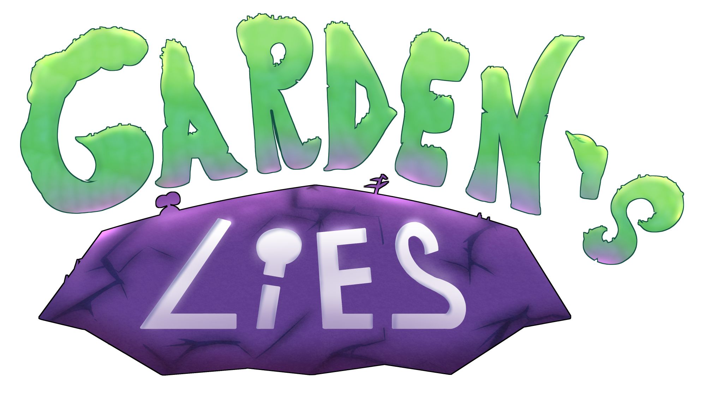
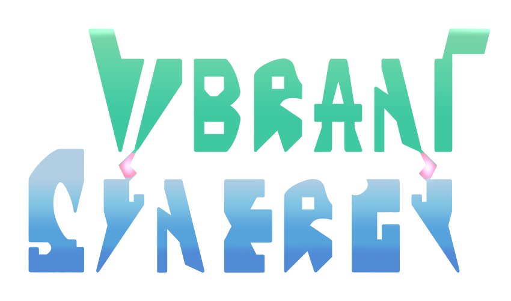

# Garden's Lies

  

Un jeu présenté par...  
  

--- 

## Synopsis du jeu

Garden's Lies est un jeu vidéo d'exploration et de réflexion se déroulant dans un univers riche et luxuriant.  
Vous y suivrez Midori, une petite fille perdue dans un monde étrange, rassurant et à la fois inquiétant, et surtout, rempli de chlorophylle.  
Grâce à son habilité, la transformation de Mimique, l'exploration progressive au cœur de la végétation ne devrait pas poser de problème... enfin, presque.  

 
Mais comment a-t-elle pu arriver ici ? Seuls ses souvenirs peuvent témoigner de la vérité...

## Pourquoi l'organisation Garden's Lies ?

Établir une organisation de ce jeu donne de nombreux avantages permettant de :  
- Rassembler des dépôts publiques liées à Garden's Lies.
- Lier les collaborateurs au même endroit.
- Utiliser les Boards GitHub depuis l'organisation.

> [!NOTE]  
> Le code source principal du jeu n'est pas exposé publiquement dans l'organisation.

## Quels dépôts sont-ils disponibles ?

Les dépôts sont là pour une variété de raisons :  
- Exposer certaines composantes du projet comme open source.
- Forker les dépôts tiers en lien avec les besoins actuelles.
- Archiver des composants maintenant inutiles.

En addition, un dépôt organise l'ensemble des Issues (Problèmes) de Garden's Lies à [cette adresse](https://github.com/Gardens-Lies/Gardens-Lies-Issues).  
En tant qu'utilisateur invité, vous pouvez en créer de nouvelles annonces afin de recenser des bogues ou des suggestions.

## Projets affiliés

### Flora Framework

(Dépôt privé et non disponible)

## Propriété intellectuelle

> [!IMPORTANT]
> © 2025-2026 Vibrant Synergy (NoixDeXydre). Tous droits réservés.  
> Garden's Lies, son nom, ses logos, son univers, son histoire, ses personnages (dont Midori),
ses graphismes, ses animations, sa musique, ses sons, ses textes et son code source sont
protégés par le droit d'auteur et, le cas échéant, par le droit des marques.  
> Sauf mention contraire dans un dépôt, aucune licence n'est accordée : toute reproduction,
modification, redistribution ou utilisation commerciale, totale ou partielle, est interdite
sans autorisation écrite préalable. Cela vaut aussi pour l'entraînement de modèles d'IA et
la création de contenus dérivés (fan-games, assets extraits, reprises de personnages.)  
> - **Dépôts open source** : seuls les dépôts publiés avec un fichier `LICENSE` sont réutilisables,
  dans les conditions de cette licence.
> - **Forks de projets tiers** : ils restent sous la licence de leur auteur d'origine ; seules nos
  modifications nous appartiennent, sous cette même licence.
> - **Fan-art et contenus de communauté** : bienvenus pour un usage non commercial, en citant
  Garden's Lies et sans laisser penser à un contenu officiel. Pour toute autre utilisation
  (stream monétisé, vidéo, presse, partenariat) : noixdexydre@mailfence.com.