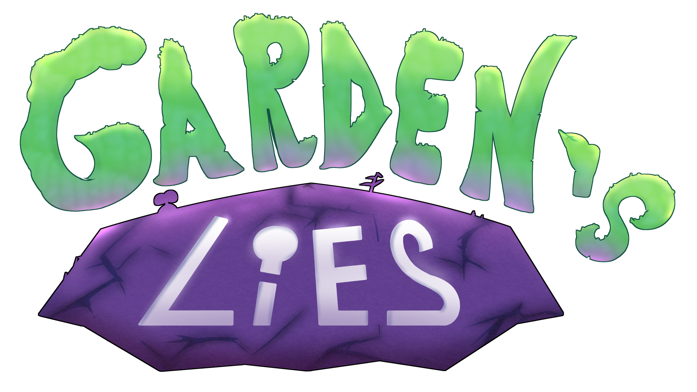

# Garden's Lies

## Synopsis du jeu

Garden's Lies est un jeu vidéo d'exploration et de réflexion se déroulant dans un univers riche et luxuriant.  
Vous y suivrez Midori, une petite fille perdue dans un monde étrange, rassurant et à la fois inquiétant, et surtout, rempli de chlorophylle.  
Grâce à son habilité, la transformation de Mimique, l'exploration progressive au cœur de la végétation ne devrait pas poser de problème... enfin, presque.  

 
Mais comment a-t-elle pu arriver ici ? Seuls ses souvenirs peuvent témoigner de la vérité...

## Pourquoi l'organisation Garden's Lies ?

Établir une organisation de ce jeu donne de nombreux avantages permettant de :  
- Rassembler des dépôts publiques liées à Garden's Lies.
- Lier les collaborateurs au même endroit.
- Utiliser les Boards GitHub depuis l'organisation.

## Quels dépôts sont-ils disponibles ?

Les dépôts sont là pour une variété de raisons :  
- Exposer certaines composantes du projet comme open source.
- Forker les dépôts tiers en lien avec les beoins actuelles.
- Archiver des composants maintenant inutiles.

En addition, un dépôt organise l'ensemble des Issues (Problèmes) de Garden's Lies à [cette adresse](https://github.com/Gardens-Lies/Gardens-Lies-Issues).  
En tant qu'utilisateur invité, vous pouvez en créer de nouvelles annonces afin de recenser des bogues ou des suggestions.

## Projets affiliés

### Flora Framework

(Dépôt privé et non disponible)